# BeltPulse-Net

**Finding foreign objects under glare and rolling on an iron-ore conveyor belt, using the belt's own motion.**
IITH MTech term project · final report, November 2026

[Web version of this report](https://virtualadhikari1993.github.io/beltpulse/) ·
[Slides (PPTX)](reports/BeltPulse_Final_Report.pptx) ·
[Architecture walkthrough](https://virtualadhikari1993.github.io/beltpulse/pipeline_architecture.html) ·
[Repository guide](#repository-guide)

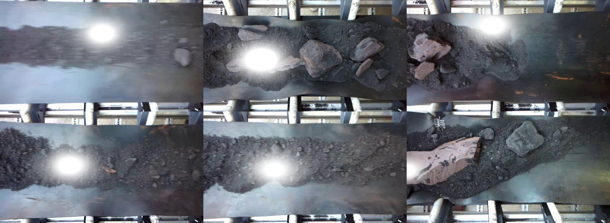

---

## Summary

A single top camera watches an iron-ore belt for foreign objects: wood, plastic, tools and wrong ore types (canga, jaspilito).
A glare spot or motion blur can wipe out an object in one frame. The belt moves at a measurable speed, though, so the same object shows up in many frames
at a predictable position. **BeltPulse-Net lines those frames up using the belt's motion and combines them**, so one bad frame matters less.

| | result (test set: 5 videos never seen in training) |
|---|---|
| **Goal met** | Objects are detected under glare, motion blur and rolling. **Every trained multi-view model beats the single-frame model.** |
| Best object IoU | **0.682** (8 views, feature average) vs **0.622** for one frame |
| Object squares hidden under glare that are found | **0.88** vs 0.81 (8 views) · 0.85 vs 0.64 (3 views) |
| Belt alignment | **+0.02 to +0.04** IoU overall, **+0.12** on one video (`canga3`), at no training cost |
| Cross-frame attention | **Same accuracy as feature averaging** (0.626 vs 0.620 over 3 seeds) and **3× more stable** across seeds (sd 0.011 vs 0.033) |
| Speed | ≈ 7 ms per frame (140–158 fps) on a laptop RTX 3050 |

---

## 1. The problem

- **What we look for:** wood, plastic, tools and wrong ore types among iron ore.
- **Why one frame is not enough:** a glare spot or motion blur can wipe out the object in that frame.
- **What we can use:** the belt moves steadily along X, so the same object appears in many frames at a predictable position.
- **Complication:** rocks roll and sticks rotate, so they don't move exactly with the belt.
- **Output:** for each frame, which squares of the image contain an impurity (a 22 × 40 grid).

## 2. Data

[Mendeley *In-lab Image Dataset of Foreign Objects and Anomalies in Iron Ore Conveyor Belts*](https://data.mendeley.com/datasets/s25x2bnshz/1) (CC BY 4.0):
**19 videos**, 1280 × 720, **26,460 frames**; the authors flag 2,990 frames as "has object" but give **no object locations**.

| split | videos | 3-view samples | 8-view samples |
|---|---|---|---|
| train | 11 videos (iron_ore 1/2/5/6, 7_wood 1/2, canga2, jaspilito 1/3, things 1/2) | 2,716 | 2,644 |
| validation | canga, jaspilito_2, iron_ore_3 | 470 | 458 |
| test (never seen) | 7_wood_3, canga3, **jaspilito_4** (real glare + rolling), things_3, iron_ore_4 (ore only) | 508 | 490 |

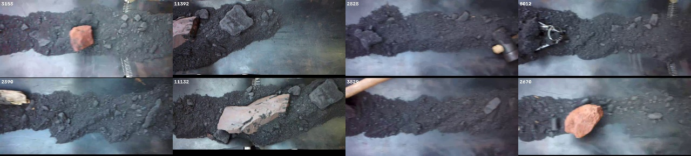

---

## 3. Method

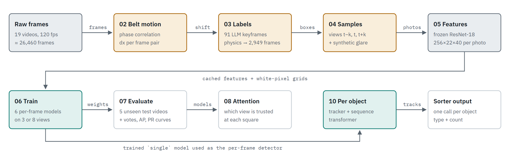

*Teal = trained · amber = fixed physics or rule (no learning) · grey = data or frozen pretrained network.*

### 3.1 Belt motion
Phase correlation between consecutive frames gives the belt shift in pixels. The vertical shift is ≈ 0 in all 19 videos, so the belt moves along X only.
The speed ranges from ~0 (belt stopped) to 48 px per frame. The shift is used twice: to copy labels between frames, and to line up views inside the model.

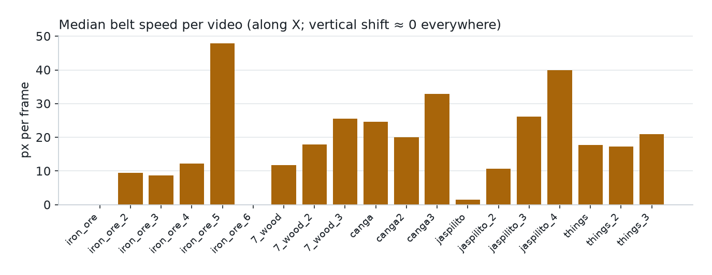

### 3.2 Labels: drawn by an LLM, corrected and reviewed by a human
No location labels existed, so they were built in four steps:
1. **LLM keyframe boxes:** an LLM drew boxes on 67 keyframes read from contact sheets.
2. **Belt-physics propagation:** the boxes were copied to neighbouring frames using the measured belt shift (2,858 more frames).
3. **Rolling correction:** two-keyframe blending, plus 24 extra LLM keyframes where objects roll (flagged when the copied box is > 60 px off). Flagged intervals dropped from 14 to 7.
4. **Human review:** all labels were reviewed and corrected by hand before the final training runs.

Result: **2,949 labelled frames, 3,355 object boxes.**

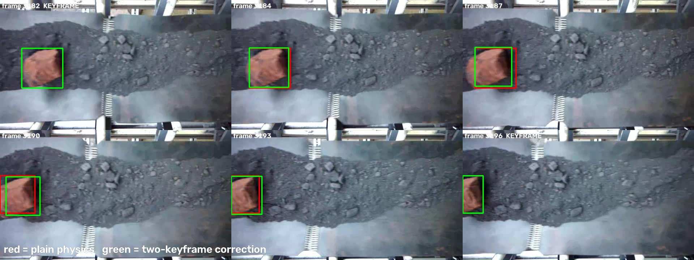

*A rolling canga rock: red = plain physics copy, green = two-keyframe correction.*

### 3.3 From a camera frame to a training sample
Frames are halved to 640 × 352, which is 40 × 22 squares of 16 px. A frozen ResNet-18 (up to layer3) gives 256 numbers per square.
A square counts as "object" if at least 25 % of it lies inside a box.

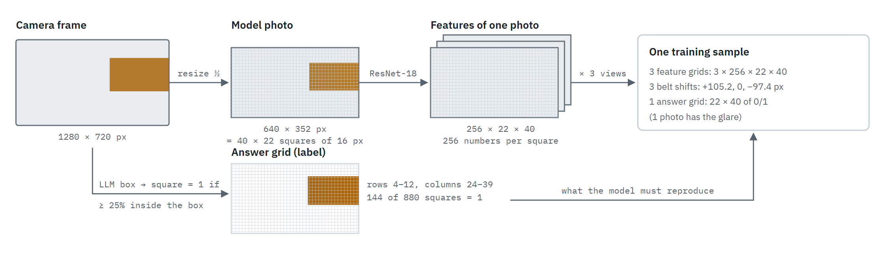

| | 3-view variant | 8-view variant (T8w7) |
|---|---|---|
| views per sample | t − k, t, t + k | t − 3k … t + 4k |
| k | smallest gap where the belt moved ≥ 96 px | same |
| attention search window | 3 × 3 squares | 7 × 7 squares (follows objects that roll off the belt path) |
| simulated glare | one random view (train); view t in half of test | each view with p = 0.3; view t in half of test |

### 3.4 The per-frame model (269k trainable parameters)
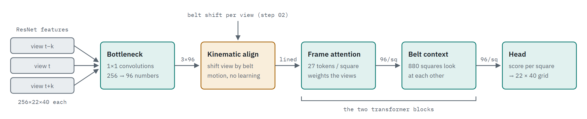

| block | parameters |
|---|---|
| position embeddings (880 squares × 96) | 84,480 |
| belt context (spatial transformer over all squares) | 74,784 |
| frame attention (q/k/v/o, 4 heads × 24) | 38,400 |
| feed-forward + norms | 37,536 |
| bottleneck 256 → 96 | 34,176 |
| head | 97 |

### 3.5 Kinematic alignment
Each view is slid by the belt shift, so the object sits in the same square in every view. This is fixed physics with no parameters.
A search window around each square absorbs rolling and labelling error.

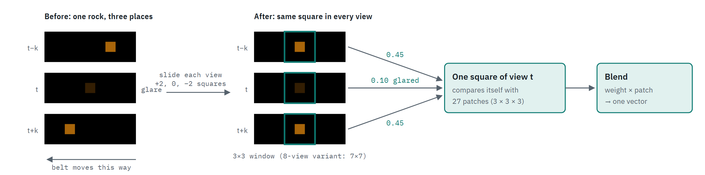

### 3.6 Cross-frame attention: a learned trust weight per view
The learned matrices W_q and W_k turn patches into queries and keys. A softmax over the match scores gives weights that sum to 1.
A glared view gets a low weight, so the blend relies on the clean views.

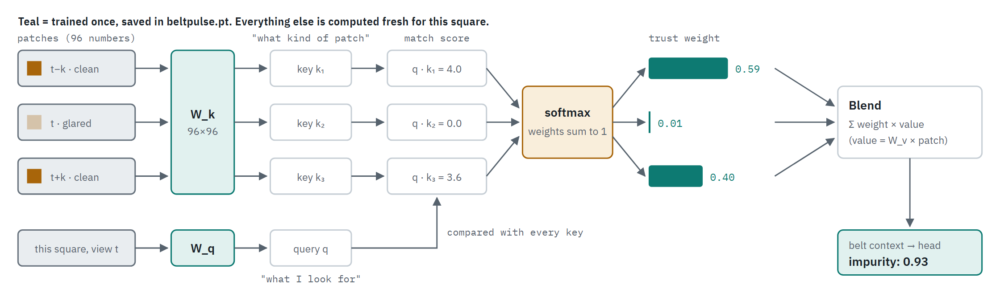

### 3.7 Six trained models and four voting baselines
All models share the backbone, bottleneck, belt-context transformer, head, loss and training schedule. **Only the fusion step differs.**

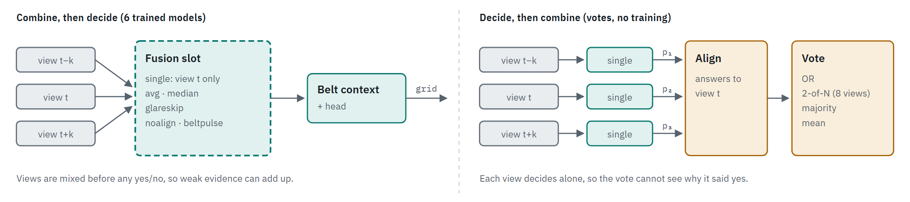

| model | how the views are combined |
|---|---|
| `single` | target frame only (reference) |
| `avg` | aligned feature average |
| `median` | aligned feature median |
| `glareskip` | average, skipping washed-out views (fixed rule) |
| `noalign` | cross-frame attention, no belt alignment |
| `beltpulse` | cross-frame attention with belt alignment |
| votes | `single` answers aligned, then OR / 2-of-N / majority / mean (no training) |

**BeltPulse-Net is the whole system:** belt motion, physics labels, aligned multi-view samples and the fusion models. Cross-frame attention is one of its fusion options.

### 3.8 Training
| setting | value |
|---|---|
| loss | BCE (object squares weighted × 5) + Dice |
| optimiser | AdamW, lr 5e-4, weight decay 1e-2, cosine schedule, 30 epochs |
| batch | 8 (3 views), 4 (8 views) |
| checkpoint | best validation object IoU |
| hardware / time | laptop RTX 3050 4 GB · 94 min for 6 models (3 views) · 6.2 h for 6 models (8 views) |

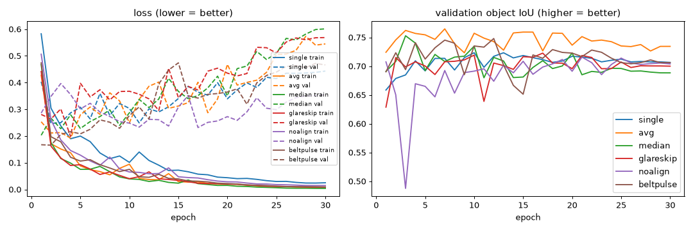

---

## 4. Results

Metric: **object IoU**, the overlap between predicted and true impurity squares, pooled over all test samples.
**Recall under glare** is the share of object squares hidden by glare in the target frame that are still found.

### 4.1 Three views: every multi-view model beats the single frame
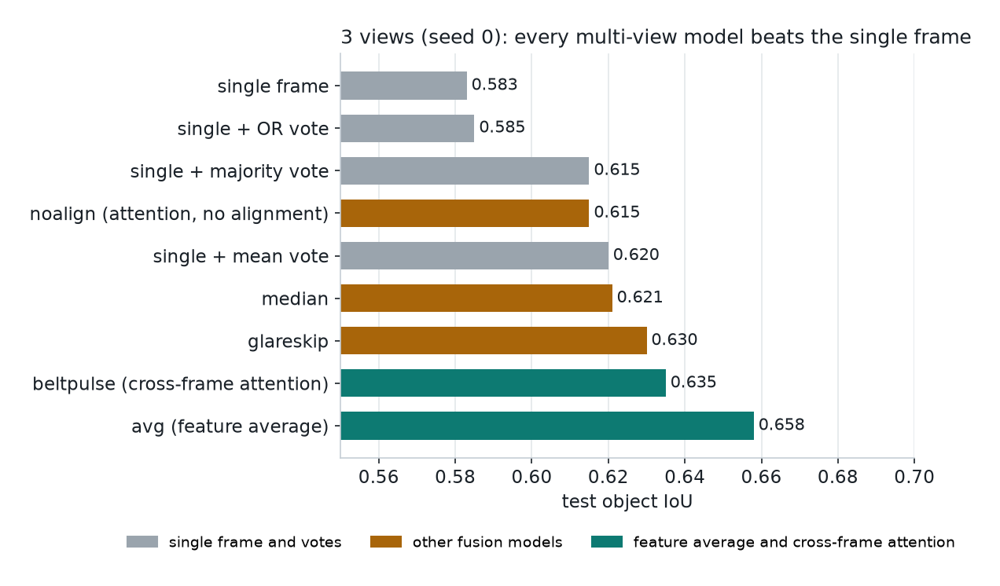

- Feature averaging gains **+0.075 IoU** over the single frame (0.658 vs 0.583). Recall under glare rises from 0.64 to 0.85.
- **Combine-then-decide wins:** fusing features beats voting on single-frame answers (best vote 0.620). The OR vote finds the most hidden squares (0.91) but doubles the false alarms.

### 4.2 Eight views: the gains grow, and alignment matters more
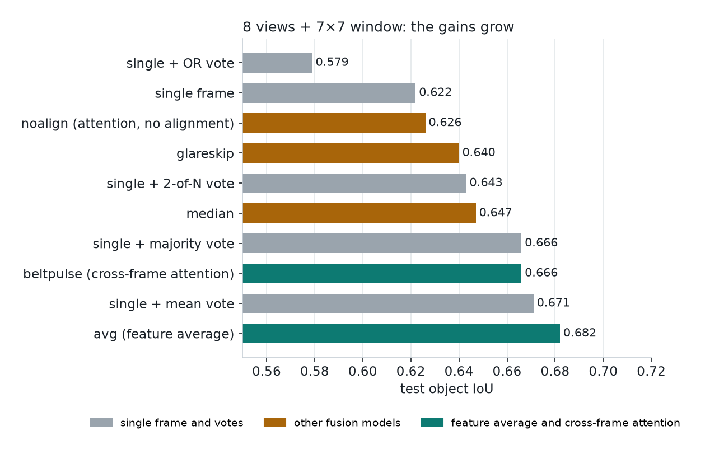

- Best: **0.682** (feature average, AP 0.892). Cross-frame attention reaches 0.666.
- Belt alignment adds **+0.040** (attention 0.666 vs noalign 0.626).
- Voting catches up: with 8 views, one glared view is outvoted 7 to 1 (mean vote 0.671).

### 4.3 More views help every multi-view model
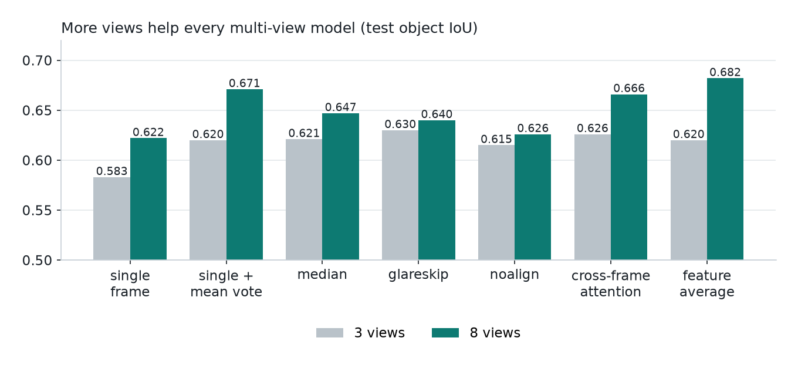

The 3-view numbers for feature average and cross-frame attention are 3-seed means. Test sets differ slightly (508 vs 490 samples), so compare trends.
The single frame only ever sees one view, so its change reflects the slightly different test set.

### 4.4 Cross-frame attention ≈ feature averaging, and 3× more stable
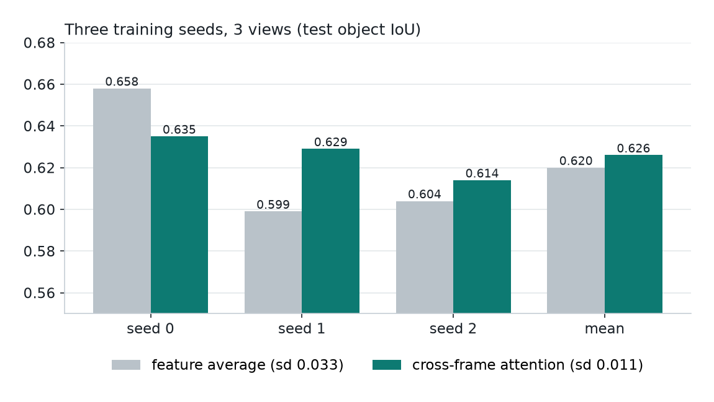

| test object IoU (3 views) | seed 0 | seed 1 | seed 2 | mean ± sd |
|---|---|---|---|---|
| feature average (`avg`) | 0.658 | 0.599 | 0.604 | 0.620 ± 0.033 |
| cross-frame attention (`beltpulse`) | 0.635 | 0.629 | 0.614 | **0.626 ± 0.011** |

- **Equivalent accuracy:** the 0.006 gap is far inside the seed-to-seed spread.
- **More reliable to train:** any single run lands close to the mean.
- **Fewer false alarms** on most test videos (e.g. `things_3`: ~2,900 vs 5,400–6,300 false-alarm squares on seeds 1–2).
- Trade-off: averaging keeps slightly higher recall under glare (0.85–0.87 vs 0.77–0.83).

### 4.5 Under glare, the glare spot is ignored and the object is kept
Columns: three input views · truth (green) · single-frame prediction (red) · multi-view (cross-frame attention) prediction (red).
The single-frame model mistakes the glare blob for an object; the multi-view model does not.

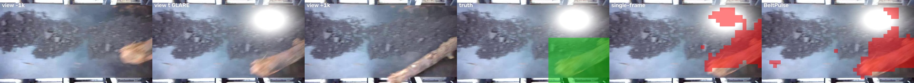
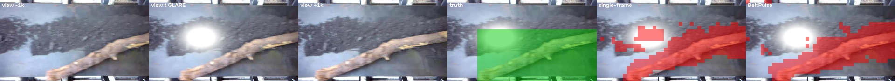
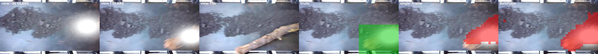

### 4.6 Real glare, motion blur and rolling: the hardest test video
`jaspilito_4` is the only test video with real (not simulated) glare, strong motion blur and two rolling intervals.

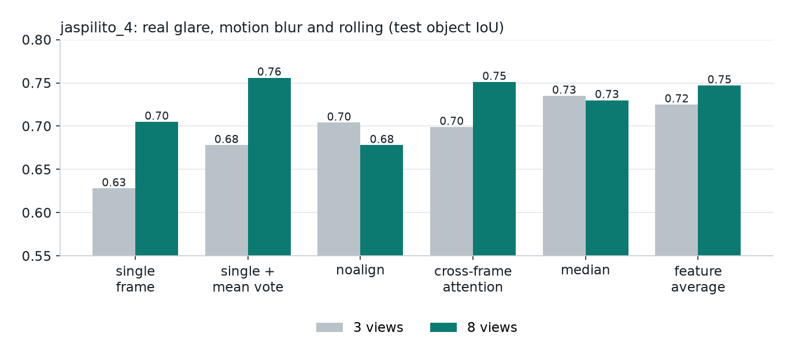

- **Detected under real glare and rolling:** with 8 views the aligned fusion models reach 0.73–0.75 IoU and the mean vote 0.76 on this video (single frame: 0.63 with 3 views, 0.70 with 8).
- With 3 views, the gain over the single frame is **+0.11** (0.628 → 0.735 median, 0.725 feature average).
- The **7 × 7 search window** lets attention follow an object that drifts off the belt path.
- **Alignment is decisive on `canga3`:** attention 0.730 vs noalign 0.612 (3 views), 0.726 vs 0.607 (8 views), with about 1,500 vs 3,800 false-alarm squares.

### 4.7 What cross-frame attention learned: distrust glared views
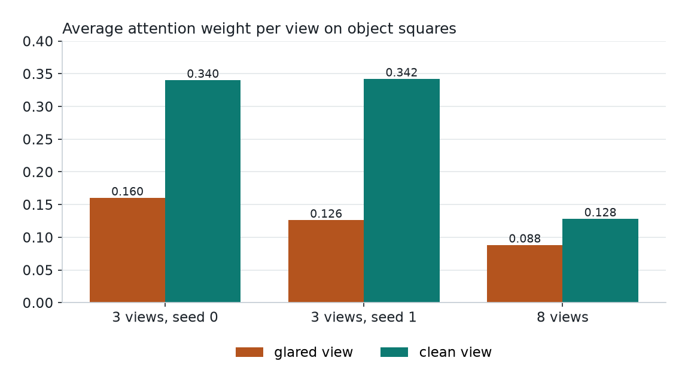

- **3 views:** a glared view gets about half the weight of a clean one (0.16 vs 0.34; equal weights would be 0.33).
- **8 views:** glared 0.088 vs clean 0.128 (equal weights would be 0.125). With many clean views available, the model needs to single out glare less.
- **Learned, not hand-coded:** no glare label was given; the model found this from the detection task alone.

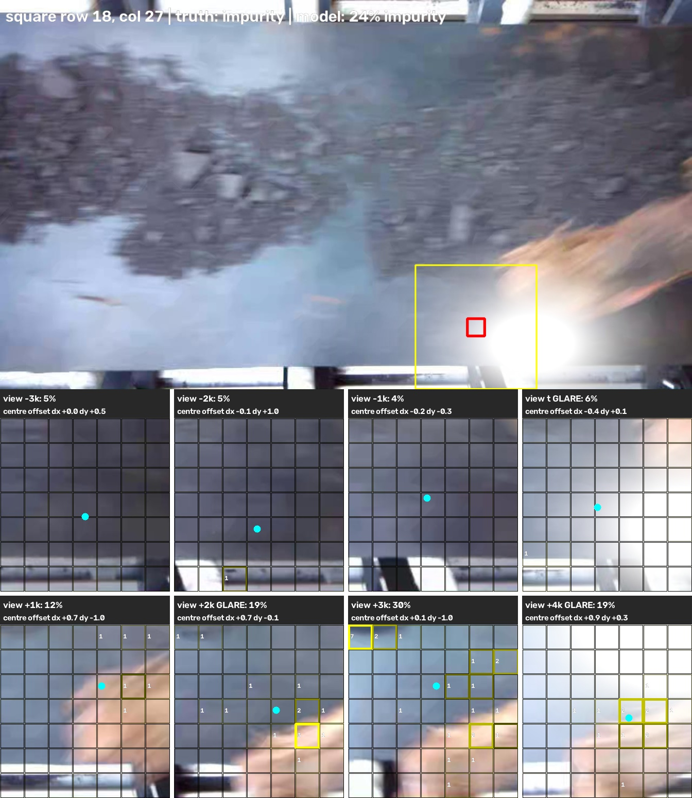

*One square under glare, 8 views: yellow = where attention looks inside each 7 × 7 window; cyan dot = its centre of mass.*

### 4.8 Per test video (8 views)
Each cell is object IoU / false-alarm squares. `iron_ore_4` is ore only, so any detection there is a false alarm; about 162,800 squares were scored on it.

| model | 7_wood_3 | canga3 | jaspilito_4 | things_3 | iron_ore_4 false alarms |
|---|---|---|---|---|---|
| single frame | 0.555 | 0.679 | 0.705 | 0.654 | 220 |
| single + mean vote | 0.587 | 0.759 | **0.756** | 0.702 | 53 |
| median | 0.564 | 0.717 | 0.730 | 0.685 | 29 |
| glareskip | 0.581 | 0.723 | 0.538 | 0.702 | 21 |
| noalign | **0.614** | 0.607 | 0.678 | 0.638 | **0** |
| cross-frame attention | 0.601 | 0.726 | 0.751 | 0.707 | 518 |
| feature average | 0.595 | **0.769** | 0.747 | **0.731** | 25 |

- Every aligned multi-view model beats the single frame on `canga3`, `things_3` and `7_wood_3`, and all except `glareskip` do on `jaspilito_4`. `noalign` (no belt alignment) falls below the single frame on `canga3`, `jaspilito_4` and `things_3`.
- False alarms stay small: even the highest, 518 squares, is 0.3 % of the ore-only video.
- `glareskip`'s fixed whiteness rule fails on real glare (0.538): it drops views that still show the object. Learned fusion avoids this.

---

## 5. Conclusions

1. **The goal is met.** Foreign objects are detected under glare, motion blur and rolling by fusing belt-aligned views. Every trained multi-view model beats the single frame
   (8 views: 0.682 vs 0.622 IoU; recall under glare 0.88 vs 0.81).
2. **Belt alignment works.** The physics shift adds +0.02 (3 views) to +0.04 (8 views) IoU, and +0.12 on `canga3`, at no training cost.
3. **More views help.** 8 views with a 7 × 7 window beat 3 views for every multi-view model.
4. **Cross-frame attention ≈ feature averaging in accuracy, and 3× more stable across seeds.** It gives fewer false alarms on most videos and a readable trust weight per view.

## 6. Limitations

- **Labels:** LLM boxes are about ±30–50 px. Human review corrected them, but square-level IoU is still limited by box precision.
- **Seeds:** there are 3 seeds for `avg` and `beltpulse` at 3 views; the 8-view run is one seed, so gaps under ~0.03 there are not significant.
- **Counting:** counting objects by connected blobs is weak (1.63 regions per object, exact count 55 %). A per-object tracker is the remedy.
- **Validation vs test:** validation IoU (~0.75) is above test (~0.65). The test videos are harder, and validation has only 3 videos.
- **Rolling:** rolling is covered by the test video and the wide window, but there is no separate rolling-only score yet.
- **Simulated glare:** most glare is painted on. `jaspilito_4` is the only real-glare test video, and multi-view still gains +0.05 to +0.11 IoU there.

## 7. Next steps

1. **Per-object decisions:** track boxes across frames with belt physics and decide once per object, which fixes counting (step 10).
2. **Rolling score (E15):** score the flagged rolling intervals separately.
3. **More 8-view seeds** for averaging and attention.
4. **Stronger backbone (E14):** DINOv2 features instead of frozen ResNet-18.
5. **Lighter model (E16):** test whether the belt-context transformer (a third of the parameters) is needed.
6. **Operating point:** tune the decision threshold for high recall vs few false alarms.

---

## Repository guide

**New here?** Start with [docs/00_simple_overview.md](docs/00_simple_overview.md), the whole project in plain words.
Per-video numbers are in [docs/data_inventory.md](docs/data_inventory.md), the full evaluation write-up is in [docs/07_evaluation.md](docs/07_evaluation.md),
and ideas beyond the core pipeline are in [docs/extensions.md](docs/extensions.md).

| # | Activity | Script(s) | Notes |
|---|----------|-----------|-------|
| 01 | Look at the data | `src/01_explore.py` | [docs/01_data_exploration.md](docs/01_data_exploration.md) |
| 02 | Measure belt motion | `src/02_belt_motion.py` | [docs/02_belt_motion.md](docs/02_belt_motion.md) |
| 03 | Labels: LLM keyframes, physics propagation, rolling correction, human review | `src/03a`–`03f` | [docs/03_labeling.md](docs/03_labeling.md) |
| 04 | 3-view samples + simulated glare | `src/04_build_samples.py` | [docs/04_build_samples.md](docs/04_build_samples.md) |
| 04b | 8 views + 7 × 7 window (variant `T8w7`) | `src/04b_build_samples_multi.py` | [docs/04b_multiview.md](docs/04b_multiview.md) |
| 05 | Extract & cache ResNet features | `src/05_extract_features.py` | [docs/05_features.md](docs/05_features.md) |
| 06 | Train the six models (`--seed N` for extra seeds) | `src/model.py`, `src/dataset.py`, `src/06_train.py` | [docs/06_model_and_training.md](docs/06_model_and_training.md) |
| 07 | Evaluate (+ votes, AP, per video) | `src/07_evaluate.py`, `src/07b_multi_object.py` | [docs/07_evaluation.md](docs/07_evaluation.md) |
| 08 | Look inside the attention | `src/08_explain_attention.py` | [docs/08_attention_explained.md](docs/08_attention_explained.md) |
| 09 | Speed check | `src/09_speed.py` | ≈ 7 ms/frame on RTX 3050 |
| 10 | One decision per object (smoke test) | `src/10_per_object.py` | [docs/10_per_object.md](docs/10_per_object.md) |
| 11 | Final report: slides + this page | `reports/final_report/` | [docs/11_final_report.md](docs/11_final_report.md) |

### Run
```powershell
# full pipeline unattended (keeps Windows awake, logs to outputs/logs/)
.venv\Scripts\python scripts\run_full.py                    # 3 views: 05 -> 06 -> 07 -> 07b -> 08
.venv\Scripts\python scripts\run_full.py --variant T8w7     # 8 views + 7x7 window
.venv\Scripts\python scripts\run_full.py --seed 1 --modes avg beltpulse --from 06   # extra seed
```
Steps 01–04 only need re-running when labels change (`03c` → `04`).

### Setup
```powershell
python -m venv .venv
.venv\Scripts\python -m pip install -r requirements.txt
.venv\Scripts\python -m pip install torch torchvision --index-url https://download.pytorch.org/whl/cu121
```

### Folder layout
```
data/raw/ironore/   original dataset (not in git)
data/labels/        keyframes, keyframe boxes, propagated boxes
src/                one script per step, numbered; common.py = shared helpers
scripts/            unattended runner and queues
outputs/<step>/     pictures and metrics produced by each step
docs/               one note per activity; docs/index.html = web report
reports/            slide decks (final: BeltPulse_Final_Report.pptx)
```
